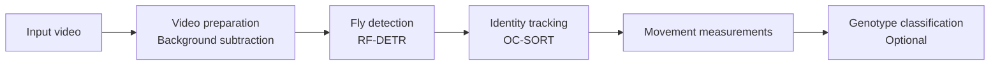

# Drosophila Climbing Behavior: Fly Tracking and Genotype Classification

This project measures climbing behavior in *Drosophila* flies.
It supports research on genotype differences in a TDP-43 model of neurodegeneration.

RF-DETR detects individual flies in video frames.
OC-SORT connects those detections across frames to form a trajectory for each fly.
The program uses these trajectories to calculate movement measurements and classify genotypes.


## Analysis stages

A pipeline is a sequence of processing stages.
This pipeline prepares the video, detects flies, tracks their identities, and calculates movement measurements.
Genotype classification is an optional final stage.



Movement measurements include velocity, area covered, and path tortuosity.
Path tortuosity describes how much a trajectory departs from a straight line.

## Technical terms

| Term | Meaning |
|---|---|
| Inference | The use of a trained model to produce detections. |
| Model weights | Values that a model learns during training. |
| Checkpoint | A file that contains model weights and model settings. |
| Region of interest (ROI) | An image area that you select for analysis. |
| Track overlay | An image or video with fly positions and identity labels over the original images. |
| Central processing unit (CPU) | The main processor in a computer. |
| Graphics processing unit (GPU) | A processor that can reduce the time for model calculations. |
| Application programming interface (API) | A software interface through which this program can request detections from an online service. |
| FP16 | A number format that uses 16-bit floating-point values. |

## 1. Install the software

Use Python 3.11 for this project.
Run the commands in a terminal.
After the download, run all other commands from the `superfly` project directory.

If the project is already on your computer, skip these download commands.

```bash
git clone https://github.com/emmavrignaud/superfly.git
cd superfly
```

Choose one installation method below.
A Python environment contains the Python version and packages for this project.

### A. Install with Conda

Conda creates a separate environment for the project.
The `environment.yml` file defines its packages.

1. Create the environment.

   ```bash
   conda env create -f environment.yml
   ```

2. Activate the environment.

   ```bash
   conda activate fly-tracking
   ```

### B. Install with pip

The `requirements.txt` file lists the packages for pip.
FFmpeg reads and writes video files.
The pip installation does not install the FFmpeg program.

1. Activate a Python 3.11 environment.
2. Install [FFmpeg](https://ffmpeg.org/download.html).
3. Make FFmpeg available on the system `PATH`.
4. If you need a specific PyTorch build, install PyTorch and torchvision first.
5. Install the project packages.

   ```bash
   python -m pip install -r requirements.txt
   ```

`PATH` tells the terminal where to find programs.
Use the [official PyTorch installer](https://pytorch.org/get-started/locally/) to select a build for your operating system and hardware.

Both installation methods include local RF-DETR (`rfdetr[plus]`), PyTorch, and torchvision.
The Conda environment also includes FFmpeg, scikit-image, TrackEval, pytest, and JupyterLab.
TrackEval uses the source code in `external/TrackEval`.
Changes to that source code affect the installed TrackEval package.

### Select CPU or GPU support

The local model can use a CPU or a compatible GPU.
A GPU can reduce processing time.
For an NVIDIA GPU, select a PyTorch build with CUDA support.
CUDA provides NVIDIA GPU support in PyTorch.

For the Conda method, install that build after you activate the environment.
For the pip method, install that build before you install `requirements.txt`.
On supported macOS devices, PyTorch can use Metal Performance Shaders (MPS).

## 2. Set up inference

The `inference.mode` setting in `config.yaml` selects local or hosted inference.
Local inference is the default.
Both modes supply detections to the same tracking stages.

### A. Local inference

Local inference runs the model on your computer.
It does not need a Roboflow API key.
The main installation includes its Python packages.

1. Obtain the trained checkpoint for the fly detector.
2. Set `inference.local.weights_path` to the checkpoint location.
3. Set `inference.local.resolution` to match the checkpoint.
4. Set `inference.local.num_classes` to match the checkpoint.
5. Set `inference.mode` to `local`.
6. If you use an NVIDIA CUDA GPU, set `inference.local.optimize_for_gpu` to `true` for FP16 optimization.
7. If you use a CPU or macOS/MPS, keep `inference.local.optimize_for_gpu` set to `false`.
8. Check the local model.

   ```bash
   python tests/check_local_model.py
   ```

The default checkpoint location is `RF-DETR_model/weights.pt`.
The repository excludes this directory, so you must supply the checkpoint separately.
The check script loads the model and makes one prediction on an artificial image.

Make all model files and supporting assets available locally before an offline run.
Local inference can then run without internet access.

### B. Hosted inference

Hosted inference sends video frames to Roboflow's online service.
The service returns detections to your computer.
This mode needs internet access and a Roboflow API key.
It does not need a local GPU or checkpoint.
The main installation includes the hosted client package.

1. Copy the credentials template.

   ```bash
   cp creds_config.example.yaml creds_config.yaml
   ```

2. Open `creds_config.yaml`.
3. Enter your Roboflow API key.
4. Check the model identifier and service address in the `roboflow` section of `config.yaml`.
5. Set `inference.mode` to `hosted`.

The repository excludes `creds_config.yaml`.
The `creds_config.example.yaml` file is the template for that file.

## 3. Set up an analysis run

The `config.yaml` file contains the settings for an analysis run.
These settings select the input video, analysis stages, tracking behavior, and output files.

1. Open `config.yaml`.
2. Set the input video path.
3. Check the inference and calibration settings.
4. Set the other options for your experiment.
5. Start the program with one method from section 4.

You do not need to edit the scripts or notebook code to change these settings.
The setup window can update settings from your selections.

| Section | Purpose |
|---|---|
| `video` | Select the input video with `raw_path`. Use `fallback_fps` if the file has no frame rate. |
| `roboflow` | `model_id` selects the hosted model. `inference_api_url` gives the service address. |
| `inference` | Select `local` or `hosted` with `mode`. Set the local checkpoint, resolution, class count, and optimization option. |
| `calibration` | Set pixels per centimeter with `px_per_cm`. Select centimeters or pixels, and seconds or frames, for the measurements. |
| `preprocessing` | Control background subtraction, brightness, video format, and the use of this stage. |
| `roi` | Select saved ROIs or open the ROI window. Set the vial count and spacing. |
| `tracker` | Set RF-DETR confidence and OC-SORT parameters. Control saved detections with `cached_detections` and recovery options with `ghost_detection`. |
| `watershed` | Separate detection boxes that contain two flies in contact. |
| `pipeline` | Set `expected_per_vial` to the expected number of flies in each vial. Control repeat processing with `skip_tracked`. |
| `visualization` | Control track overlays with `enabled`. Select their source images with `overlay_source`. Set the frame rate and display style. |
| `features` | Select movement measurements, such as velocity, area covered, and path tortuosity. |
| `latent_space` | Select PCA, t-SNE, or UMAP settings to compare patterns in movement measurements. |
| `classification` | Select the classification method with `method`. Set its model parameters. |

Frame rate is the number of video frames per second.

PCA means principal component analysis.
t-SNE means t-distributed stochastic neighbor embedding.
UMAP means uniform manifold approximation and projection.
These methods represent multiple measurements in fewer dimensions for analysis or display.

## 4. Run the analysis

Choose one of the four methods below.
All four methods use the same tracking code and configuration file.
The program saves results in `data/outputs/run_<N>_<short_name>/`.
The `<N>` value is the run number.
The `<short_name>` value identifies the video.

A command-line option changes the current run.
It does not change `config.yaml`.
Replace example video paths with paths to your own files.

### A. Use the setup window

The setup window lets you select a video, crop area, and frame range.
You can draw vial ROIs and set the fly count and color for each vial.
The window also has options for track overlays and saved ROIs.

Open the setup window.

```bash
python scripts/app.py
```

To select a video before the window opens, use this command.

```bash
python scripts/app.py --video data/raw/clip.mp4
```

### B. Use the tracking notebook

The notebook shows the analysis stages separately.
JupyterLab opens the notebook in your browser.

```bash
jupyter lab notebooks/01_tracking_pipeline.ipynb
```

### C. Process one video from the command line

Use the video path from `config.yaml`.

```bash
python scripts/run_tracking.py
```

To select another video, use this command.

```bash
python scripts/run_tracking.py --video data/raw/clip.mp4
```

You can select these additional options.

```bash
python scripts/run_tracking.py --reuse-roi
python scripts/run_tracking.py --overlay
python scripts/run_tracking.py --no-overlay
```

| Option | Effect |
|---|---|
| `--reuse-roi` | Use saved crop and vial ROIs without the ROI window. |
| `--overlay` | Write track overlay videos for this run. |
| `--no-overlay` | Do not write track overlay videos for this run. |

If you omit both overlay options, `visualization.enabled` controls the output.
If the video has saved ROIs, use `--reuse-roi` to select them.

### D. Process multiple videos

The `scripts/run_all.py` program processes videos from a directory.
Stage 1 performs tracking.
Stage 2 performs statistical analysis of the tracking results.
Stage 2 runs only when you add `--analysis`.

Process every video in a directory.

```bash
python scripts/run_all.py --data-root data/raw
```

To add statistical analysis, use this command.

```bash
python scripts/run_all.py --data-root data/raw --analysis
```

To draw all crop and vial ROIs before processing, use this command.

```bash
python scripts/run_all.py --data-root data/raw --draw-first
```

To analyze existing results without more tracking, use this command.

```bash
python scripts/run_all.py --skip-tracking --analysis
```

By default, the program repeats tracking for each video.
To skip existing results, set `pipeline.skip_tracked` to `true` in `config.yaml`.
The program then skips videos with an existing `ordered_tracks.csv` file.

## 5. Classify genotypes

Genotype classification is optional.
It uses movement measurements from a completed tracking run.
The classification settings are in `config.yaml`.
The program supports linear discriminant analysis (LDA), logistic regression, and a support vector classifier (SVC).

1. Select a run directory that contains `ordered_tracks.csv` and `run_params.json`.
2. Set the classification method and parameters in `config.yaml`.
3. Run the classification program.

   ```bash
   python scripts/run_classification.py --run-dir data/outputs/run_5_13DPE_n001
   ```

Replace the example directory with your run directory.
To also create an HTML report, add `--report-site`.
HTML means Hypertext Markup Language.
Web browsers display HTML reports.

```bash
python scripts/run_classification.py --run-dir <run> --report-site
```

Replace `<run>` with your run directory before you run this command.

## Output files

Each run has a directory in `data/outputs/`.
The selected stages and options determine which files the program creates.

| File | Contents |
|---|---|
| `<video_name>.mp4` | A copy or file link to the input video. |
| `crop_roi.json` | The crop area and frame range from video preparation. |
| `vial_rois.json` | The position and size of each vial ROI. |
| `detections_raw.csv` | RF-DETR detections before tracking. The program can reuse these detections. |
| `ocsort_tracks.csv` | Tracking results with one row for each frame. |
| `ocsort_tracks_long.csv` | Tracking results with one row for each frame and fly identity. |
| `ordered_tracks.csv` | Tracks with vial assignments and an `ordered_id` from left to right. |
| `tracker_log.json` | A record of tracking decisions, missed detections, and track suppression. |
| `run_params.json` | Settings and metadata for each stage. |
| `metrics_report.md` and `metrics_report.html` | Reports that help you assess tracking results. |
| `<video_stem>_detections_RF-DETR.mp4` | A video with detection and track overlays, when enabled. |
| `overlay_raw_ocsort.mp4` | A video with the original OC-SORT track labels. |
| `overlay_ordered.mp4` | A video with the ordered track labels. |

`<video_stem>` means the video filename without its extension.
CSV means comma-separated values.
CSV files contain data tables.
JSON means JavaScript Object Notation.
JSON files contain settings or structured records.

The repository excludes generated files in `data/outputs/` and `data/annotations/`.
The `.gitkeep` files preserve the directory locations in the repository.

## Project files

| Path | Purpose |
|---|---|
| `config.yaml` | Settings for an analysis run. |
| `creds_config.example.yaml` | A credentials template for optional hosted inference. |
| `environment.yml` | The Conda environment definition. |
| `requirements.txt` | The pip package list for this project and local RF-DETR. |
| `utils.py` | Shared functions for configuration, metadata, and output files. |
| `roi_library.json` | Saved crop and vial ROIs for each video name. |
| `RF-DETR_model/weights.pt` | The trained checkpoint for local inference. |
| `external/TrackEval/` | TrackEval source code for tracking metrics. |
| `data/` | Input videos and analysis results. |
| `notebooks/01_tracking_pipeline.ipynb` | Tracking analysis in a Jupyter notebook. |
| `notebooks/02_classification_analysis.ipynb` | Classification analysis in a Jupyter notebook. |
| `scripts/app.py` | The setup window for an analysis run. |
| `scripts/run_tracking.py` | Tracking for one video. |
| `scripts/run_all.py` | Tracking and optional statistical analysis for multiple videos. |
| `scripts/run_classification.py` | Genotype classification from a completed run. |
| `scripts/populate_roi_library.py` | ROI selection for videos in an experiment directory. |
| `parameter_tuning/` | Parameter comparisons against labeled reference data and HOTA scores. |
| `labeler/` | A separate window for detection labels. |
| `tests/` | Automated checks and the local model check. |

### Analysis source files

| File in `src/` | Purpose |
|---|---|
| `inference_backends.py` | Local and hosted RF-DETR inference. |
| `preprocessing.py` | Background subtraction, image crop, and frame selection. |
| `roi.py` | Vial ROI selection and fly identity order within each vial. |
| `tracking.py` | The connection between RF-DETR detections and OC-SORT tracking. |
| `watershed_split.py` | Separation of detection boxes that contain flies in contact. |
| `wide_long.py` | Conversion from one row per frame to one row per frame and fly identity. |
| `visualization.py` | Videos with detection and track overlays. |
| `metrics.py` | Tracking reports, counts per vial, and HOTA scores. |
| `ocsort.py` | The OC-SORT tracker. |
| `kalmanfilter.py` | Position and motion estimates for each track. |
| `association.py` | Detection-to-track links from IoU measures and Hungarian matching. |
| `features.py` | Velocity, area covered, path tortuosity, and other movement measurements. |
| `statistics.py` | Group comparisons with Kruskal-Wallis tests and Cliff's delta. |
| `classification.py` | Genotype classification with LDA, logistic regression, or SVC. |
| `latent_space.py` | PCA, t-SNE, and UMAP representations of movement measurements. |
| `forecasting.py` | Movement prediction with a multilayer perceptron (MLP) and genotype information. |
| `plot_colors.py` | Consistent Plotly colors for genotype groups. |
| `ui_context.py` | Shared functions for PyQt windows. |

HOTA means Higher Order Tracking Accuracy.
It combines detection accuracy and identity association accuracy.
IoU means intersection over union.
It measures the overlap between two detection boxes.
Hungarian matching selects detection-to-track pairs from a cost matrix.
An MLP is a type of neural network.

## Check the installation

Run the automated tests.

```bash
pytest tests/ -v
```

These tests do not need a Roboflow key, video files, or a GPU.
Check that all tests pass.
Use the local model check in section 2 to check model loading and prediction.

## Acknowledgments

The [Laboratory of Neural Genetics and Disease (McCabe Lab)](https://www.epfl.ch/labs/mccabelab/) at EPFL supported this project.

- RF-DETR: [Roboflow](https://roboflow.com)
- OC-SORT: [boxmot](https://github.com/mikel-brostrom/boxmot)
